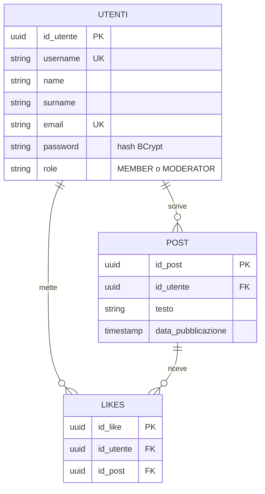

🇮🇹 Italiano · 🇬🇧 [English](README.md)

# Social Network API

REST API per un piccolo social network: gli utenti si registrano e fanno login, pubblicano e modificano post e mettono like ai post degli altri. L'autenticazione è stateless con JWT, e l'autorizzazione combina i ruoli (`MEMBER`, `MODERATOR`) con la proprietà della risorsa.

Progetto realizzato durante il corso di [EPICODE Institute of Technology](https://epicode.com): solo backend, senza frontend. Il codice, i percorsi degli endpoint e i messaggi di errore sono in italiano.

## Esempio

Creazione di un post con il token restituito da `POST /api/auth/login`:

```bash
curl -X POST http://localhost:3001/api/post \
  -H "Authorization: Bearer <token>" \
  -H "Content-Type: application/json" \
  -d '{"testo":"Hello from the Social Network API!"}'
```

`201 Created`

```json
{
  "id": "959a123b-0c8c-4e21-8f42-e7d7be03c831",
  "testo": "Hello from the Social Network API!",
  "dataPubblicazione": "2026-11-16T11:57:23.7440966",
  "authorId": "66b08073-1bcc-4723-b989-d28a88d26cdd",
  "authorUsername": "mario.rossi"
}
```

Se un altro utente, che non è né l'autore né un moderatore, prova a modificare quel post con `PUT /api/post/{id}`:

`403 Forbidden`

```json
{
  "timestamp": "2026-11-16T11:57:24.0580712",
  "status": 403,
  "error": "Forbidden",
  "message": "Non hai i permessi per accedere a questa risorsa",
  "path": "/api/post/959a123b-0c8c-4e21-8f42-e7d7be03c831"
}
```

## Funzionalità

**Utenti**
- Registrazione con Bean Validation: username di almeno 3 caratteri, nome e cognome obbligatori, email valida, password di almeno 8 caratteri. Tutti i campi non validi vengono segnalati in un unico messaggio.
- Username ed email devono essere unici (altrimenti `400`).
- Le password sono salvate come hash BCrypt e non vengono mai restituite: le risposte usano un DTO senza password.
- I nuovi utenti hanno il ruolo `MEMBER`.

**Post**
- Creazione, elenco, lettura e modifica dei post. La data di pubblicazione la imposta il server.
- La risposta include id e username dell'autore.

**Like**
- Mettere e togliere il like a un post. Un utente può mettere like a un post una sola volta: il secondo like restituisce `400`, e anche il database ha un vincolo di unicità su (utente, post). Togliere un like che non esiste restituisce `404`.

**Errori**
- Un `@RestControllerAdvice` trasforma ogni eccezione nello stesso corpo JSON: `timestamp`, `status`, `error`, `message`, `path`.

## Endpoint

Tutte le rotte tranne registrazione e login richiedono `Authorization: Bearer <token>`.

| Metodo | Percorso | Accesso | Risposta |
|---|---|---|---|
| `POST` | `/api/auth/register` | Pubblico | `201` con l'utente creato |
| `POST` | `/api/auth/login` | Pubblico | `200` con `{ "token": "..." }` |
| `GET` | `/api/utenti/me` | Autenticato | Profilo dell'utente corrente |
| `GET` | `/api/utenti` | Autenticato | Tutti gli utenti |
| `GET` | `/api/utenti/{id}` | Autenticato | Un utente |
| `PATCH` | `/api/utenti/{id}/role` | `MODERATOR` | Cambia il ruolo: `{ "role": "MEMBER" \| "MODERATOR" }` |
| `POST` | `/api/post` | Autenticato | `201` con il post creato |
| `GET` | `/api/post` | Autenticato | Tutti i post |
| `GET` | `/api/post/{id}` | Autenticato | Un post |
| `PUT` | `/api/post/{id}` | Autore o `MODERATOR` | Modifica il testo del post |
| `POST` | `/api/like/{postId}` | Autenticato | `201`, like a nome dell'utente corrente |
| `DELETE` | `/api/like/{postId}` | Autenticato | `204`, toglie il like dell'utente corrente |

## Autenticazione e autorizzazione

**JWT**
- `POST /api/auth/login` riceve username e password e restituisce un token firmato con HMAC-SHA usando `JWT_SECRET` (jjwt). Username sbagliato e password sbagliata restituiscono lo stesso `401`.
- Il `subject` del token è l'**id** dell'utente, non lo username, e il token vale **31 giorni**.
- `JWTFilter` verifica firma e scadenza a ogni richiesta protetta, poi carica l'utente dal database. I ruoli quindi arrivano dal database, non dal token: un cambio di ruolo vale dalla richiesta successiva, senza rifare il login. Un token il cui utente non esiste più viene rifiutato con `401`.
- La protezione CSRF è disattivata: il token viaggia nell'header `Authorization`, non in un cookie.

**Tre livelli di autorizzazione**, ognuno scelto in base a dove si trova l'informazione che serve per decidere:

| Meccanismo | Cosa decide | Dove |
|---|---|---|
| `JWTFilter` + `SecurityConfig` | La richiesta è autenticata? | Tutte le rotte tranne `/api/auth/**` |
| `@PreAuthorize("hasRole('MODERATOR')")` | Basta il ruolo di chi chiama | `PATCH /api/utenti/{id}/role` |
| Controllo nel service | Servono dati della risorsa: chi ha scritto *questo* post | `PUT /api/post/{id}` in `PostService.update` |

- **Cambiare un ruolo** dipende solo da chi chiama, quindi la regola è dichiarata sul controller. `@PreAuthorize` restituisce `403` prima che il metodo venga eseguito.
- **Modificare un post** dipende dall'autore del post, che va caricato dal database. `PostService` permette la modifica se chi chiama è l'autore o un `MODERATOR`; altrimenti lancia l'`AccessDeniedException` di Spring Security, che il gestore delle eccezioni trasforma in `403`.
- **I like** agiscono sull'utente ricavato dal token. URL e body non dicono mai "a nome di chi", quindi è impossibile per costruzione mettere o togliere un like a nome di un altro.

## Modello dati



`likes` ha un vincolo di unicità su (`id_utente`, `id_post`). Lo schema viene creato e aggiornato da Hibernate (`ddl-auto=update`).

## Stack tecnico

| Tecnologia | Versione |
|---|---|
| Java | 25 |
| Spring Boot (Web MVC, Security, Data JPA, Validation) | 4.1.1 |
| jjwt (`jjwt-api`, `jjwt-impl`, `jjwt-jackson`) | 0.12.6 |
| Driver JDBC PostgreSQL | da Spring Boot |
| PostgreSQL | 16 (usato in sviluppo) |
| Lombok | da Spring Boot |
| Maven (wrapper) | 3.9.16 |

## Architettura

```
Progetto-Settimana-3/
  controllers/   AuthController, UserController, PostController, LikeController
  services/      UserService (registrazione, login, ruoli), PostService (controllo sull'autore), LikeService
  repositories/  repository Spring Data JPA
  entities/      User (implementa UserDetails), Post, Like, Role
  dto/           record di richiesta e risposta, con Bean Validation
  security/      SecurityConfig, JWTFilter, JwtTool
  exceptions/    eccezioni custom e GlobalExceptionHandler
```

## Avvio in locale

### Prerequisiti

- JDK 25
- PostgreSQL

### 1. Clonare il repository

```bash
git clone https://github.com/TheRedKardinal/social-network-api.git
cd social-network-api/Progetto-Settimana-3
```

### 2. Database

```bash
createdb -U postgres socialnetworkII
```

Le tabelle vengono create al primo avvio.

### 3. Variabili d'ambiente

```bash
cp .env.example .env     # poi compila i valori
```

| Variabile | Scopo | Default |
|---|---|---|
| `DB_URL` | URL JDBC di PostgreSQL | `jdbc:postgresql://localhost:5432/socialnetworkII` |
| `DB_USERNAME` | Utente del database | `postgres` |
| `DB_PASSWORD` | Password del database | nessuno, obbligatoria |
| `JWT_SECRET` | Chiave per firmare i JWT, almeno 32 caratteri | nessuno, obbligatoria |

L'applicazione legge `.env` dalla cartella del progetto tramite `spring.config.import`. Funzionano anche le normali variabili d'ambiente. `.env` è nel `.gitignore`.

### 4. Avvio

```bash
./mvnw spring-boot:run   # Windows: mvnw.cmd spring-boot:run
```

L'API parte su `http://localhost:3001`.

### 5. Diventare moderatore

Ogni nuovo utente è `MEMBER`, e solo un `MODERATOR` può cambiare i ruoli. Per creare il primo moderatore bisogna aggiornare direttamente il database:

```sql
UPDATE utenti SET role = 'MODERATOR' WHERE username = 'tuo-username';
```

Il nuovo ruolo vale dalla richiesta successiva, con lo stesso token.

## Provare le API

**Postman.** Importa `Progetto-Settimana-3/ProgettoSettimana3.postman_collection.json`. La variabile `baseUrl` è già `http://localhost:3001`. La collection ha 19 richieste in quattro cartelle (Auth, Utenti, Post, Like). Le richieste di registrazione generano utenti casuali, quindi si può rieseguire senza errori di duplicato, e quelle di login salvano i token per le richieste successive. Copre anche gli errori attesi: password sbagliata (`401`), token mancante (`401`), cambio di ruolo da parte di un membro (`403`), modifica da parte di chi non è l'autore (`403`), doppio like (`400`).

**curl.** Per esempio:

```bash
# Registrazione
curl -X POST http://localhost:3001/api/auth/register \
  -H "Content-Type: application/json" \
  -d '{"username":"mario.rossi","name":"Mario","surname":"Rossi","email":"mario.rossi@example.com","password":"password123"}'

# Login: copia il token dalla risposta
curl -X POST http://localhost:3001/api/auth/login \
  -H "Content-Type: application/json" \
  -d '{"username":"mario.rossi","password":"password123"}'

# Utente corrente
curl http://localhost:3001/api/utenti/me -H "Authorization: Bearer <token>"

# Like a un post
curl -X POST http://localhost:3001/api/like/<postId> -H "Authorization: Bearer <token>"
```

## Test

```bash
cd Progetto-Settimana-3
./mvnw test
```

C'è un solo smoke test (`ProgettoSettimana3ApplicationTests`) che verifica che il contesto Spring si avvii. Si collega al database PostgreSQL configurato in `DB_URL`, quindi il database deve essere attivo e le variabili devono essere impostate.

## Autore

Claudio Giasi: [GitHub](https://github.com/TheRedKardinal) · [LinkedIn](https://www.linkedin.com/in/claudio-giasi/)

---

Questo progetto non è pubblicato online: per provarlo, avvialo in locale seguendo [Avvio in locale](#avvio-in-locale).
