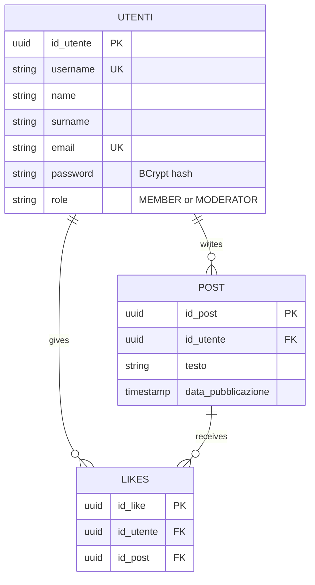

🇬🇧 English · 🇮🇹 [Italiano](README.it.md)

# Social Network API

A REST API for a small social network: users sign up and log in, publish and edit posts, and like other people's posts. Authentication is stateless with JWT, and authorization combines roles (`MEMBER`, `MODERATOR`) with ownership of the resource.

Built as a course project at [EPICODE Institute of Technology](https://epicode.com): backend only, with no frontend. The codebase, the endpoint paths and the error messages are in Italian (`utenti` = users, `testo` = text, `data_pubblicazione` = publication date, `Post non trovato` = post not found).

## Example

Create a post with the token returned by `POST /api/auth/login`:

```bash
curl -X POST http://localhost:3001/api/post \
  -H "Authorization: Bearer <token>" \
  -H "Content-Type: application/json" \
  -d '{"testo":"Hello from the Social Network API!"}'
```

`201 Created`

```json
{
  "id": "959a123b-0c8c-4e21-8f42-e7d7be03c831",
  "testo": "Hello from the Social Network API!",
  "dataPubblicazione": "2026-11-16T11:57:23.7440966",
  "authorId": "66b08073-1bcc-4723-b989-d28a88d26cdd",
  "authorUsername": "mario.rossi"
}
```

If another user, who is neither the author nor a moderator, tries to edit that post with `PUT /api/post/{id}`:

`403 Forbidden`

```json
{
  "timestamp": "2026-11-16T11:57:24.0580712",
  "status": 403,
  "error": "Forbidden",
  "message": "Non hai i permessi per accedere a questa risorsa",
  "path": "/api/post/959a123b-0c8c-4e21-8f42-e7d7be03c831"
}
```

## Features

**Users**
- Sign-up with Bean Validation: username of at least 3 characters, required first and last name, valid email, password of at least 8 characters. All invalid fields are reported in a single message.
- Username and email must be unique (`400` otherwise).
- Passwords are hashed with BCrypt and never returned: responses use a DTO without the password.
- New users get the `MEMBER` role.

**Posts**
- Create, list, read and edit posts. The publication date is set by the server.
- The response includes the author's id and username.

**Likes**
- Like and unlike a post. A user can like a post only once: a second like returns `400`, and the database also has a unique constraint on (user, post). Removing a like that does not exist returns `404`.

**Errors**
- A `@RestControllerAdvice` turns every exception into the same JSON body: `timestamp`, `status`, `error`, `message`, `path`.

## Endpoints

All routes except register and login require `Authorization: Bearer <token>`.

| Method | Path | Access | Response |
|---|---|---|---|
| `POST` | `/api/auth/register` | Public | `201` with the created user |
| `POST` | `/api/auth/login` | Public | `200` with `{ "token": "..." }` |
| `GET` | `/api/utenti/me` | Logged in | Profile of the current user |
| `GET` | `/api/utenti` | Logged in | All users |
| `GET` | `/api/utenti/{id}` | Logged in | One user |
| `PATCH` | `/api/utenti/{id}/role` | `MODERATOR` | Changes the role: `{ "role": "MEMBER" \| "MODERATOR" }` |
| `POST` | `/api/post` | Logged in | `201` with the created post |
| `GET` | `/api/post` | Logged in | All posts |
| `GET` | `/api/post/{id}` | Logged in | One post |
| `PUT` | `/api/post/{id}` | Author or `MODERATOR` | Edits the text of the post |
| `POST` | `/api/like/{postId}` | Logged in | `201`, like as the current user |
| `DELETE` | `/api/like/{postId}` | Logged in | `204`, removes the current user's like |

## Authentication and authorization

**JWT**
- `POST /api/auth/login` takes a username and a password and returns a token signed with HMAC-SHA using `JWT_SECRET` (jjwt). Wrong username and wrong password return the same `401`.
- The token's subject is the user's **id**, not the username, and it is valid for **31 days**.
- `JWTFilter` checks the signature and the expiry on every protected request, then loads the user from the database. The roles therefore come from the database, not from the token: a role change applies to the next request, without logging in again. A token whose user no longer exists is rejected with `401`.
- CSRF protection is disabled: the token travels in the `Authorization` header, not in a cookie.

**Three levels of authorization**, each chosen by where the information needed for the decision lives:

| Mechanism | What it decides | Where |
|---|---|---|
| `JWTFilter` + `SecurityConfig` | Is the request authenticated? | Every route except `/api/auth/**` |
| `@PreAuthorize("hasRole('MODERATOR')")` | The caller's role alone is enough | `PATCH /api/utenti/{id}/role` |
| Check in the service layer | Needs data from the resource: who wrote *this* post | `PUT /api/post/{id}` in `PostService.update` |

- **Changing a role** depends only on who is calling, so it is declared on the controller. `@PreAuthorize` returns `403` before the method runs.
- **Editing a post** depends on the post's author, which has to be loaded from the database. `PostService` allows the edit if the caller is the author or a `MODERATOR`; otherwise it throws Spring Security's `AccessDeniedException`, which the exception handler turns into `403`.
- **Likes** act on the user taken from the token. The URL and the body never say "on behalf of whom", so it is impossible by design to like, or remove a like, as someone else.

## Data model



`likes` has a unique constraint on (`id_utente`, `id_post`). The schema is created and updated by Hibernate (`ddl-auto=update`).

## Tech stack

| Technology | Version |
|---|---|
| Java | 25 |
| Spring Boot (Web MVC, Security, Data JPA, Validation) | 4.1.1 |
| jjwt (`jjwt-api`, `jjwt-impl`, `jjwt-jackson`) | 0.12.6 |
| PostgreSQL JDBC driver | from Spring Boot |
| PostgreSQL | 16 (used in development) |
| Lombok | from Spring Boot |
| Maven (wrapper) | 3.9.16 |

## Architecture

```
Progetto-Settimana-3/
  controllers/   AuthController, UserController, PostController, LikeController
  services/      UserService (register, login, roles), PostService (ownership check), LikeService
  repositories/  Spring Data JPA repositories
  entities/      User (implements UserDetails), Post, Like, Role
  dto/           request and response records, with Bean Validation
  security/      SecurityConfig, JWTFilter, JwtTool
  exceptions/    custom exceptions and GlobalExceptionHandler
```

## Getting started

### Prerequisites

- JDK 25
- PostgreSQL

### 1. Clone

```bash
git clone https://github.com/TheRedKardinal/social-network-api.git
cd social-network-api/Progetto-Settimana-3
```

### 2. Database

```bash
createdb -U postgres socialnetworkII
```

The tables are created on the first startup.

### 3. Environment variables

```bash
cp .env.example .env     # then fill in the values
```

| Variable | Purpose | Default |
|---|---|---|
| `DB_URL` | PostgreSQL JDBC URL | `jdbc:postgresql://localhost:5432/socialnetworkII` |
| `DB_USERNAME` | Database user | `postgres` |
| `DB_PASSWORD` | Database password | none, required |
| `JWT_SECRET` | Key used to sign JWTs, at least 32 characters | none, required |

The application reads `.env` from the project folder through `spring.config.import`. Real environment variables work too. `.env` is git-ignored.

### 4. Run

```bash
./mvnw spring-boot:run   # Windows: mvnw.cmd spring-boot:run
```

The API starts on `http://localhost:3001`.

### 5. Become a moderator

Every new user is a `MEMBER`, and only a `MODERATOR` can change roles. To create the first moderator, update the database directly:

```sql
UPDATE utenti SET role = 'MODERATOR' WHERE username = 'your-username';
```

The new role applies from the next request, with the same token.

## Trying the API

**Postman.** Import `Progetto-Settimana-3/ProgettoSettimana3.postman_collection.json`. The `baseUrl` variable is already `http://localhost:3001`. The collection has 19 requests in four folders (Auth, Utenti, Post, Like). The register requests generate random users, so it can be run again without duplicate errors, and the login requests save the tokens for the next ones. It also covers the expected errors: wrong password (`401`), missing token (`401`), role change by a member (`403`), edit by someone who is not the author (`403`), double like (`400`).

**curl.** For example:

```bash
# Sign up
curl -X POST http://localhost:3001/api/auth/register \
  -H "Content-Type: application/json" \
  -d '{"username":"mario.rossi","name":"Mario","surname":"Rossi","email":"mario.rossi@example.com","password":"password123"}'

# Log in and copy the token
curl -X POST http://localhost:3001/api/auth/login \
  -H "Content-Type: application/json" \
  -d '{"username":"mario.rossi","password":"password123"}'

# Current user
curl http://localhost:3001/api/utenti/me -H "Authorization: Bearer <token>"

# Like a post
curl -X POST http://localhost:3001/api/like/<postId> -H "Authorization: Bearer <token>"
```

## Running tests

```bash
cd Progetto-Settimana-3
./mvnw test
```

There is one smoke test (`ProgettoSettimana3ApplicationTests`) that checks that the Spring context starts. It connects to the PostgreSQL database configured in `DB_URL`, so the database must be running and the variables must be set.

## Author

Claudio Giasi: [GitHub](https://github.com/TheRedKardinal) · [LinkedIn](https://www.linkedin.com/in/claudio-giasi/)

---

This project is not deployed online: to try it, run it locally by following [Getting started](#getting-started).
